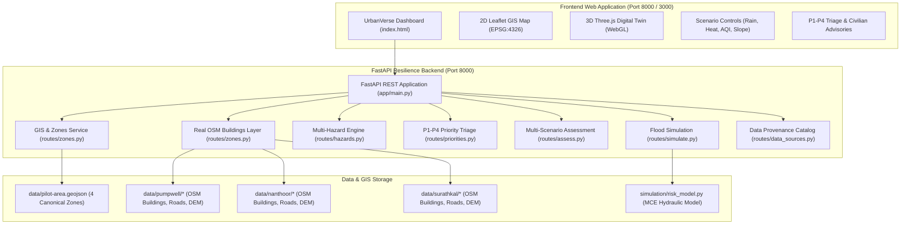

# 🏙️ UrbanVerse

> **AI-Assisted Urban Resilience Digital Twin for Multi-Hazard Prediction & Emergency Response Planning**  
> *A 24-Hour Hackathon Prototype Calibrated for the Coastal City of Mangalore, Karnataka, India.*

[](https://fastapi.tiangolo.com)
[](https://www.python.org)
[](https://leafletjs.com)
[](https://threejs.org)
[](https://www.openstreetmap.org)
[](backend/test_api.py)
[](LICENSE)

---

## 📌 Executive Summary & Problem Statement

Coastal cities like **Mangalore** face severe, compounding climate and urban hazards during the Indian monsoon:
* **Severe Tidal & River Estuary Inundation**: Low-lying sectors like Bunder ($4\text{m}$ elevation) experience tidal backflow from the Gurupura River estuary.
* **Critical Highway Bottlenecks**: Major arterial junctions like **Pumpwell (Mahaveer Circle)** on NH-66 suffer paralyzing waterlogging every single monsoon, stranding emergency vehicles and cutting off hospital access.
* **Compound Multi-Hazards**: Beyond flooding, cities experience intense **Urban Heat Islands (UHI)** in commercial centers (Hampankatta), severe **Air Pollution (AQI)** along port freight corridors (Baikampady), and rainfall-induced **cutting slope landslides** on laterite ridges (Kadri / Nanthoor).

### The Current Problem
Current government emergency alerts are broad and blunt (e.g., *"Red Alert for Dakshina Kannada district"*). They do not tell citizens or emergency responders **which micro-zone will submerge, which specific roads are blocked, or where to deploy pumps before roads are impassable.**

### The UrbanVerse Solution
**UrbanVerse** bridges this gap by creating an interactive, city-scale **Urban Digital Twin** combining real OpenStreetMap spatial layers, satellite digital elevation models (DEM), a multi-hazard predictive heuristic engine, and a 4-tier resilience triage system (**P1 Critical to P4 Low**).

---

## ✨ Key Platform Features

### 1. Dual Spatial Exploration: 2D GIS Map & 3D Structural Twin
* **2D GIS Map (Leaflet.js)**: Fast, low-bandwidth spatial triage interface for emergency dispatchers and field personnel. Delivers real-time zone risk color coding, hover tooltips, and infrastructure markers.
* **3D Digital Twin (Three.js)**: High-fidelity isometric 3D city visualization featuring elevated terrain platforms matching actual topography ($4\text{m}$ to $24\text{m}$) and a **dynamic water plane that rises physically in 3D** as rainfall increases.
* **Jury Justification**: 2D is optimized for rapid regional triage; 3D is optimized for structural inundation and elevation analysis.

### 2. Real-World Mangalore Hotspots & OpenStreetMap Ingestion
Includes real surveyed geometries from OpenStreetMap (OSM) and 30-meter satellite DEM elevation rasters for Mangalore’s three most critical transit and hazard corridors:
* **🌊 Pumpwell (Mahaveer Circle, 12m)**: 22 real building footprints (including Indiana Hospital), 78 road segments, 5 waterways, and 30m DEM elevation raster.
* **⛰️ Nanthoor Junction (36m–78m)**: 147 real surveyed buildings and 105 road segments on the elevated Kadri laterite ridge (safe evacuation corridor).
* **🏖️ Surathkal Coastal Suburb (13m)**: 32 buildings and 88 road segments prone to Arabian Sea surge.

### 3. Multi-Hazard Predictive Engine
Simulates 4 interconnected urban hazards using transparent mathematical heuristics:
1. **Urban Flooding**: Elevation vulnerability ($40\%$), river proximity ($35\%$), and drainage deficit ($25\%$) scaled by non-linear rainfall volume.
2. **Urban Heat Island (UHI)**: Surface thermal anomalies based on asphalt/concrete density vs. tree canopy cover.
3. **Air Pollution Exposure**: Localized AQI dispersion along logistics corridors and port transit routes.
4. **Slope Instability / Landslide**: Geomorphological slope failure on elevated cutting slopes (Kadri Ridge).

### 4. 4-Tier Resilience Hierarchy & Civilian Evacuation Triage
Zones are ranked from highest to lowest Composite Risk:
$$\text{Composite Risk} = 0.55 \times \text{Hazard} + (0.25 \times \text{Exposure} + 0.20 \times \text{Vulnerability}) \times \text{Hazard Activation}$$

| Tier | Priority Label | Trigger Criteria | Action Required |
| :---: | :--- | :--- | :--- |
| **P1** | **Critical** | Composite $\ge 75$ or Hazard $\ge 90$ | Immediate evacuation alert; deploy dewatering pumps to low-lying outfalls. |
| **P2** | **High** | $55 \le \text{Composite} < 75$ | Pre-position mobile pumps; issue traffic rerouting advisories. |
| **P3** | **Moderate** | $35 \le \text{Composite} < 55$ | Municipal monitoring; clear culverts and open pedestrian cooling shelters. |
| **P4** | **Low / Safe** | Composite $< 35$ | Routine baseline operations; designated safe civilian refuge zones. |

---

## 🏗️ System Architecture



---

## 📡 Complete REST API Endpoints Catalog

Interactive Swagger UI documentation is available live at **`http://localhost:8000/docs`**.

| Method | Endpoint Path | Primary Purpose | Sample Parameters / Body |
| :---: | :--- | :--- | :--- |
| `GET` | `/app` | Serves the interactive Digital Twin web dashboard | *None* |
| `GET` | `/api/health` | Service health, version check & prototype verification | *None* |
| `GET` | `/api/zones` | 4 pilot area GeoJSON boundaries (`UV001`–`UV004`) | *None* |
| `GET` | `/api/buildings/{area}` | Real OpenStreetMap building footprints | `area`: `pumpwell`, `nanthoor`, `surathkal` |
| `POST` | `/api/simulate` | Simulates flood risk for rainfall slider | `{"rainfall_mm": 80.0}` |
| `GET` | `/api/hazards` | Catalog of 4 hazards & mathematical methodology | *None* |
| `GET` | `/api/priorities` | P1–P4 resilience ranking & sub-priority sorting | `?rainfall_mm=80&temperature_c=36.5&aqi=165` |
| `POST` | `/api/assess` | Comprehensive multi-hazard custom scenario | `{"rainfall_mm": 100, "temperature_c": 38, ...}` |
| `GET` | `/api/zones/{id}/assets` | Monitored critical infrastructure inventory | `id`: `UV001` to `UV004` |
| `GET` | `/api/data-sources/status` | Ingestion status & provenance verification | *None* |

---

## 🚀 Quick Start Guide (Run Locally in 2 Minutes)

### Prerequisites
* Python 3.10+ (Tested on Python 3.12)
* Any modern web browser (Chrome, Edge, Firefox, Safari)

### 1. Clone & Enter Repository
```bash
git clone https://github.com/CryptedOG/UrbanVerse.git
cd UrbanVerse
```

### 2. Start the Backend API & Digital Twin Server
```powershell
# Windows (PowerShell)
cd UrbanVerse
& "backend/.venv/Scripts/python.exe" backend/run.py

# Linux / macOS
cd UrbanVerse
python3 -m venv backend/.venv
source backend/.venv/bin/activate
pip install -r backend/requirements.txt
python backend/run.py
```

### 3. Open in Browser
* **Interactive Digital Twin Dashboard**: **[http://127.0.0.1:8000/app](http://127.0.0.1:8000/app)**
* **Interactive Swagger API Documentation**: **[http://127.0.0.1:8000/docs](http://127.0.0.1:8000/docs)**
* **Service Health Check**: **[http://127.0.0.1:8000/api/health](http://127.0.0.1:8000/api/health)**

---

## 🧪 Automated Verification & Test Suite

UrbanVerse includes a comprehensive automated test suite verifying all API endpoints, mathematical risk bounds, and GIS resilience:

```powershell
# 1. Run all 12 backend integration and security tests
& "backend/.venv/Scripts/python.exe" backend/test_api.py

# 2. Run all 9 flood simulation unit tests
& "backend/.venv/Scripts/python.exe" -m unittest discover -s simulation -p "test_*.py"
```

**Verification Outcome**: **21/21 Automated Tests Passed with 0 Failures and 0 Errors**.

---

## 👥 Team Roles & Contributions

UrbanVerse was built collaboratively by a 4-member team during a 24-hour hackathon:

| Member & Role | Primary Focus & Deliverables |
| :--- | :--- |
| **Member 1: Backend & Integration Lead** *(Pratham U)* | Architecture coordination, FastAPI production backend, 7 API routes, P1–P4 composite risk engine, and the 21-test verification suite. |
| **Member 2: Frontend & 3D Digital Twin** *(Rakshita Shet)* | User interface layout, 2D Leaflet GIS map integration, 3D Three.js terrain platform modeling, dynamic water rise, and scenario slider controls. |
| **Member 3: GIS Data & Map Integration** *(Rakshan Kulal)* | GeoJSON RFC 7946 pilot area modeling, Overpass API OpenStreetMap dataset curation (Pumpwell, Nanthoor, Surathkal), and 30m DEM raster elevation processing. |
| **Member 4: Flood Simulation & Risk Logic** *(Shreyas Kottary)* | Weighted Multi-Criteria Evaluation (MCE) hydraulic simulation engine, factor normalization algorithms, and simulation unit tests. |

---

## ⚖️ Scientific & Ethical Disclaimer

UrbanVerse is a decision-support prototype created strictly for educational and hackathon demonstration purposes. 

* Every API response includes `"simulation_only": true`.
* Underlying geographic datasets (buildings, roads, elevation) are observed real-world OpenStreetMap and Copernicus DEM data.
* Hazard inputs (rainfall, heat, AQI) are **simulated user scenario parameters** designed for contingency planning, tabletop exercises, and municipal resource pre-positioning. They do not constitute official real-time meteorological forecasts or legal emergency warnings.

---

## 📄 License
This project is open-source and distributed under the **MIT License**.
